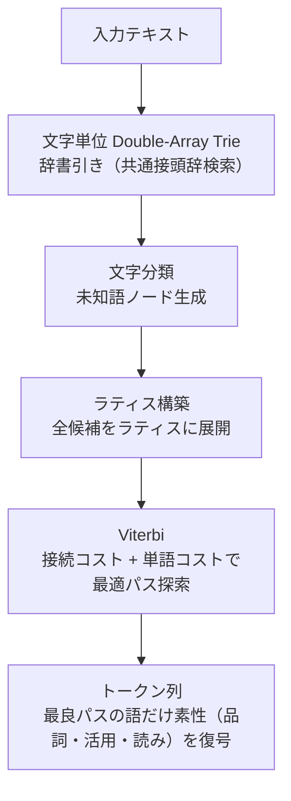

<p align="center">
  
</p>

<h1 align="center">hasami</h1>

<p align="center">
  MeCab 形式の辞書（IPAdic・NEologd・SudachiDict）に対応して読み・発音まで返し、辞書なしで動く文分割も備えた Rust 製の高速な日本語形態素解析エンジン
</p>

<!-- standard:badges:start -->
<h3 align="center">対応プラットフォーム</h3>

<p align="center">
  
  
  
</p>

<p align="center">
  <a href="https://github.com/owayo/hasami/actions/workflows/ci.yml"></a>
  <a href="https://github.com/owayo/hasami/releases/latest"></a>
  <a href="LICENSE"></a>
</p>
<!-- standard:badges:end -->

---

hasami は、MeCab などの外部の解析エンジンを使わずに Rust で一から書いた日本語の形態素解析器です。MeCab 形式の CSV から独自の形式の辞書（`.hsd`）を作り、mmap でそのまま読み込んで解析します。

配布辞書は IPAdic と、それに NEologd・SudachiDict を足した 3 つです。hasami 独自の語彙を追加し、読み上げや品詞を手がかりにする処理（音声合成の読み、文章の検査など）で誤りの元になるエントリを修復・除去してから、リリースに添付しています。コマンドのほか、Rust・Python・C のライブラリとしても使えます。

## 機能

- **外部エンジンに依存しない**: MeCab や Sudachi を呼ばず、辞書の構築から解析までを hasami だけで行います
- **ラティスと Viterbi**: 辞書の語と未知語の候補をラティスに並べ、接続コストと単語コストの和が最小になる分け方を選びます
- **並列解析**: `hasami tokenize` は標準入力の行を CPU の数だけ並列に解析します。1 スレッドの API と Python バインディングの実測は [ベンチマーク](#ベンチマーク) にあります
- **読みと発音**: トークンごとに読みと発音を返します。数量の半角数字は位取りで読みます（10分 → ジュップン、1,000円 → センエン）。文脈で読みが変わる語（「他」「数」など）、数詞と助数詞の音便（「三本」「一回」「三百」など）、1〜2 文字の英字の略語（AI・PC など）も、解析の後で読みを直します
- **MeCab 形式の辞書から作る**: MeCab 形式の CSV と matrix.def・char.def・unk.def から辞書を作ります。配布辞書は IPAdic、IPAdic + NEologd、IPAdic + NEologd + SudachiDict の 3 つで、SudachiDict は IPAdic の品詞体系に写して足します。UniDic は手元でビルドできます
- **辞書のマージと修復**: 既存の辞書に MeCab 形式の CSV を足せます。`hasami repair` は、誤読や誤った品詞の元になるエントリを直すか取り除きます
- **すぐに読み込める辞書**: 辞書は mmap でそのまま参照する形式（.hsd v5）です。読み込むときはヘッダと小さな表だけを検査し、本体は解析で触れたページだけを読みます
- **未知語の推定**: 文字の種類から未知語を推定します（char.def と unk.def を MeCab と同じ意味で読みます）。カタカナの複合語は辞書の語に分けます（「オススメ / アプリ」）
- **辞書の要らない文分割**: `hasami::sentence` は辞書を読み込まずに文の境界を求めます（feature なしで使え、依存もありません）。`Yahoo!ニュース`・`モーニング娘。` のように文末記号を含む語の内側では切りません
- **Rust・Python・C から使える**: Rust のライブラリ、Python バインディング（PyO3）、C FFI があります

## hasami を使ったツール

- [kotonoha](https://github.com/owayo/kotonoha): 音声合成に使うラベル・音素とトーン・韻律記号を生成する日本語韻律エンジンです。hasami をテキストの形態素解析に使っています。
- [noslop](https://github.com/owayo/noslop): 日本語の文章やコード内の文言から「AI 臭さ」や読みづらさを指摘する Linter です。hasami の文分割と形態素解析を使い、「の」の連鎖や連続漢字などを検査します。

## インストール

<!-- standard:install:start -->
### Cargo

Rust 1.98 以上が必要です。

```bash
cargo install --git https://github.com/owayo/hasami hasami --locked
```

### GitHub Releases から

[Releases](https://github.com/owayo/hasami/releases/latest) から自分の環境のアーカイブを取得して展開し、`hasami` を `PATH` の通った場所に置きます。各リリースには、取得したファイルを確かめるための `SHA256SUMS` も添付しています。

| プラットフォーム | ファイル |
|---|---|
| Linux (x86_64) | `hasami-x86_64-unknown-linux-gnu.tar.gz` |
| Linux (ARM64) | `hasami-aarch64-unknown-linux-gnu.tar.gz` |
| macOS (Intel) | `hasami-x86_64-apple-darwin.tar.gz` |
| macOS (Apple Silicon) | `hasami-aarch64-apple-darwin.tar.gz` |
| Windows (x86_64) | `hasami-x86_64-pc-windows-msvc.zip` |

macOS でブラウザから取得した場合は、実行の前に隔離属性を外します: `xattr -d com.apple.quarantine hasami`。

### ソースから

[mise](https://mise.jdx.dev/) が必要です (Rust のツールチェーンは `mise.toml` で固定しています)。

```bash
git clone https://github.com/owayo/hasami.git
cd hasami
make install
```

`make install` は `/usr/local/bin` に入れます。場所を変えるときは `INSTALL_PATH` を指定します (例: `make install INSTALL_PATH="$HOME/.local/bin"`)。
<!-- standard:install:end -->

### 辞書の取得

辞書はバイナリにもリポジトリにも入っていないので、入れた後に配布辞書を取ります。`hasami dict download` は、実行している hasami と同じ版のリリースから辞書を取り、置き場所（既定は `~/.local/share/hasami/`、Windows は `%LOCALAPPDATA%\hasami\`）に置きます。

```bash
hasami dict download                    # 推奨辞書（ipadic-neologd-sudachi）を置き場所に置く
hasami dict download --all              # 配布辞書 3 つをすべて取る
hasami tokenize "形態素解析のテスト"    # --dict を省くと、置いた辞書を使う
```

ソースから入れて開発するときは、辞書を `dict/` に置きます。
独自の辞書入力 CSV は非公開で管理しています。配布辞書は公開リリースから取得でき、
hasami 本体のビルドに CSV は必要ありません。辞書の再構築には独自入力へのアクセス権が必要です。

```bash
make dict-download   # この版のリリースから 3 辞書を dict/ に取る
make dict            # 上流のソースから作る
```

取り方のオプションと置き場所の決まり方は [docs/dictionaries.md](docs/dictionaries.md) にあります。

## 使い方

### 形態素解析 (CLI)

```bash
# 辞書を置き場所に取っておけば --dict は要らない（下の例は --dict で辞書を指定する）
hasami dict download
hasami tokenize "東京都に住んでいる"

# MeCab形式で出力
hasami tokenize --dict dict/ipadic-neologd.hsd "東京都に住んでいる"

# 分かち書き
hasami tokenize --dict dict/ipadic-neologd.hsd --format wakachi "東京都に住んでいる"

# JSON形式
hasami tokenize --dict dict/ipadic-neologd.hsd --format json "東京都に住んでいる"

# 標準入力から
echo "形態素解析のテスト" | hasami tokenize --dict dict/ipadic-neologd.hsd

# --dict を省くと、環境変数 HASAMI_DICT → 置き場所（既定は ~/.local/share/hasami/）の *.hsd の順に辞書を探す
HASAMI_DICT=dict/ipadic-neologd-sudachi.hsd hasami tokenize "形態素解析のテスト"
hasami tokenize -d "$(hasami dict path ipadic)" "形態素解析のテスト"   # 置き場所の ipadic を使う

# 大量の行は並列に解析する（-j の既定は CPU の数。出力の順序は入力どおり。-j 1 で 1 スレッド）
hasami tokenize --dict dict/ipadic-neologd.hsd -j 4 < corpus.txt > corpus.mecab
```

MeCab 形式の出力は次のようになります（`ipadic-neologd.hsd`）。

```text
東京都	名詞,固有名詞,地域,一般,*,*,東京都,トウキョウト,トーキョート
に	助詞,格助詞,一般,*,*,*,に,ニ,ニ
住ん	動詞,自立,*,*,五段・マ行,連用タ接続,住む,スン,スン
で	助詞,接続助詞,*,*,*,*,で,デ,デ
いる	動詞,非自立,*,*,一段,基本形,いる,イル,イル
EOS
```

タブの後ろは品詞 4 列・活用型・活用形・原形・読み・発音の 9 列で、空の素性は `*` になります。

標準入力は行ごとに解析します（前後の空白を除き、空行は飛ばします）。空の入力は出力せず正常終了します。出力はまとめて書き出しますが、次の入力を待つ前にはそれまでの結果を書き出すので、1 行ずつ送って結果を読む使い方もできます。

### Rust

crates.io には公開していないので、git の依存として使います（`hasami` の名前は crates.io では別のプロジェクトが使っています）。

```toml
[dependencies]
# 解析まで（Analyzer・Dictionary・Token と sentence）。依存は memmap2 と bytemuck だけになる
hasami = { git = "https://github.com/owayo/hasami", default-features = false, features = ["analyzer"] }
```

```rust
use hasami::Analyzer;

let mut analyzer = Analyzer::load("dict/ipadic-neologd.hsd")?;
let tokens = analyzer.tokenize("東京都に住んでいる");

for token in &tokens {
    println!("{}\t{}\t{}", token.surface, token.pos, token.reading);
}
```

feature の選び方と版の固定、辞書の取得と埋め込み、文分割、品詞の正規化、並行解析は [docs/rust-api.md](docs/rust-api.md) にあります。

### Python と C

Python バインディング（`hasami-python/`）は PyPI に公開していないので、このリポジトリから maturin で入れます。

```python
import hasami

# 辞書をロード
analyzer = hasami.Analyzer("dict/ipadic-neologd.hsd")

# 形態素解析
tokens = analyzer.tokenize("東京都に住んでいる")
for token in tokens:
    print(f"{token.surface}\t{token.pos}")
```

入れ方と API は [docs/python-api.md](docs/python-api.md) に、C から使うときの関数は [docs/c-api.md](docs/c-api.md) にあります。

## 辞書

配布辞書は 3 つあり、リリースに添付しています（リポジトリには置いていません）。
下表は 2026-10-27 のベンチマークで使った正式版 26.10.107 の配布辞書の大きさです（非圧縮 `.hsd`、MB は 1,000,000B）。

| 辞書 | 内容 | 大きさ | 推奨用途 |
|------|------|------:|---------|
| `ipadic` | IPAdic（独自補正・追加済み） | 16.5 MB | 軽量・基本用途 |
| `ipadic-neologd` | IPAdic（独自補正・追加済み）+ NEologd | 206.6 MB | 新語・固有名詞対応 |
| `ipadic-neologd-sudachi` | IPAdic（独自補正・追加済み）+ NEologd + SudachiDict | 221.0 MB | **推奨**（最大語彙） |

配布辞書には、hasami 独自の語彙追加と、読み・発音・品詞・分割の改善を適用しています。

- **語彙の追加**: 上流で不足している技術・業務・科学分野の用語や略語、日常語を、読み・発音・品詞付きで追加します。「深掘り」「腹落ち」のように意図した単位で分かれない語も補います
- **読み・発音の修復**: 誤読の原因になるエントリを修復・除去し、SudachiDict の読みから失われる長音の発音も補います
- **品詞の修正**: 「成果物」「可視化」など、固有名詞として登録された一般語を一般名詞などに直します。「ユースケース」など、個別の修正が必要な語は削除・追加エントリで補います
- **分割と記号・単位の改善**: 文や句を 1 語の名詞にするエントリや、数と単位をまとめた固有名詞エントリを除きます。未知の記号の扱いも調整し、`%`・`℃`・`㎏` などの単位に読みと助数詞の品詞を付けます

`ipadic` は記号・未知語の補正、単位・半角数字などの追加、誤読の原因になる外国人名エントリの除去を適用しています。
`ipadic-neologd` と `ipadic-neologd-sudachi` は、これに加えて独自の用語・略語・日常語の追加と、上記の修復一式を適用しています。
独自の追加・削除 CSV は非公開で管理していますが、改善済みの辞書は公開リリースから取得できます。

- [docs/dictionaries.md](docs/dictionaries.md): 取り方のオプション、置き場所、上流のソースからのビルド、手動での構築、辞書形式（.hsd）、配布辞書のライセンス
- [docs/dictionary-repair.md](docs/dictionary-repair.md): `hasami repair` の修復（文や句の名詞・数と単位の組の削除、一般語の固有名詞の降格、外国人名の除去）

## アーキテクチャ



空白と未知語の扱いは、MeCab と比べながら [docs/architecture.md](docs/architecture.md) で説明しています。

## ベンチマーク

2026-10-27、正式版 **26.10.107** を測定しました。AMD Ryzen 7 5700X（8 コア・16 論理 CPU）・RAM 32 GiB、Windows 11 10.0.26300 x64。
入力は青空文庫の夏目漱石『坊っちゃん』482 行・265,281 B。Rust 1.99.1、Python 3.14.10、Temurin Java 27+35、uv 0.13.5、Gradle 9.8.2、hyperfine 2.0.0 を使いました。
Python 3.15 では mecab-python3 1.0.12 をビルドできなかったため、全 Python 構成を 3.14 系の最新版 3.14.10 にそろえています。

| 実装 | 版 | 辞書 |
| --- | --- | --- |
| hasami Rust / 公式 PyO3 | 26.10.107、同じ [commit 2ef769e](https://github.com/owayo/hasami/commit/2ef769ea807669652e2b36fc7189bc104f74789a) | [v26.10.107 の配布辞書](https://github.com/owayo/hasami/releases/tag/v26.10.107) 3 種、形式 v5、公開サイズ・SHA-256 と全件検証を確認 |
| MeCab C / mecab-python3 | 0.996 / 1.0.12、同じ同梱 DLL | IPAdic 2.7.0-20070801（ipadic 1.0.0 のコンパイル済み UTF-8 辞書） |
| Sudachi Java | 0.8.2 | SudachiDict 20260723.1 core / V1、A モード |
| sudachi.rs / SudachiPy | 0.7.0 | Java 版と同じ辞書・A モード |

hasami の測定には、[上記の独自改善](#辞書)を適用した辞書を使っています。`ipadic` にも記号・単位・半角数字などの補正・追加があり、NEologd を含む 2 辞書には hasami 独自の用語・略語・日常語の追加と、誤読・発音・品詞・分割の修復を適用しています。各表の辞書名は元にした上流の組み合わせを示し、MeCab・Sudachi とは収録語彙や修復内容が異なります。

全行を 10 周ウォームアップし、10 周を計測する新しいプロセスを、順序を変えて 6 ラウンド実行しました。
全行解析は 1 周の中央値（各 60 標本、計 660 標本）です。ロードとロード＋最初の 1 行は各 6 標本。
API 区間は解析・表層・UTF-8 位置・checksum の消費を含み、入力読込と JSON 書式化は区間外です。
解析を呼ぶスレッドは 1 本、affinity は全 16 論理 CPU、優先度は通常です。
Java は `-Xms256m -Xmx1g`、GC/JIT の補助スレッドも通常動作のままです。

- **IQR ms（四分位範囲）**: 第3四分位数から第1四分位数を引いた値で、中央 50% の測定時間が収まる幅です。小さいほど、その範囲の測定時間のばらつきが小さくなります。
- **CV（変動係数）**: 標準偏差を平均時間で割った、単位のない値です。小さいほど、平均時間に対するばらつきが小さく、安定しています。`0.03` は標準偏差が平均時間の約 3% という意味です。

処理の速さは時間の中央値で判断します。IQR と CV は測定時間の安定性を示し、IQR は中央の測定値、CV は外れ値を含む全測定値のばらつきを反映します。

### ネイティブ API

| 実装・辞書 | ロード ms | ロード＋初回 ms | 全行解析 ms | IQR ms | CV |
| --- | ---: | ---: | ---: | ---: | ---: |
| hasami / IPAdic | 0.226 | 0.298 | 20.931 | 0.785 | 0.04 |
| hasami / IPAdic + NEologd | 0.221 | 0.316 | 23.385 | 0.832 | 0.03 |
| hasami / IPAdic + NEologd + SudachiDict | 0.217 | 0.288 | 22.742 | 1.152 | 0.04 |
| MeCab C / IPAdic | 0.476 | 0.507 | 14.912 | 0.579 | 0.04 |
| Sudachi Java / core A | 97.438 | 105.151 | 93.515 | 4.202 | 0.15 |
| sudachi.rs / core A | 35.069 | 35.137 | 68.236 | 2.119 | 0.04 |

### Python API

呼出し・トークンオブジェクトの生成と処理・UTF-8 変換・checksum の Python ループを含みます。モジュール import はロード区間の外です。

| 実装・辞書 | ロード ms | ロード＋初回 ms | 全行解析 ms | IQR ms | CV |
| --- | ---: | ---: | ---: | ---: | ---: |
| hasami Python / IPAdic | 0.196 | 0.274 | 218.928 | 3.965 | 0.01 |
| hasami Python / IPAdic + NEologd | 0.215 | 0.296 | 222.373 | 8.276 | 0.02 |
| hasami Python / IPAdic + NEologd + SudachiDict | 0.225 | 0.321 | 220.887 | 6.567 | 0.02 |
| mecab-python3 / IPAdic | 2.208 | 2.257 | 206.911 | 6.304 | 0.04 |
| SudachiPy / core A | 48.456 | 48.593 | 266.036 | 5.384 | 0.01 |

### プロセス全体の時間と最大メモリ

hyperfine は専用アダプタの起動・入力・ロード・全行解析・測定 JSON 出力までの中央値（warmup 2・10 回）です。
最大 Working Set は入力・辞書・runtime・warmup・全反復を含むプロセス全体の中央値（6 プロセス）。
初回だけの値ではなく、macOS/Linux の RSS と区別しています。

| 実装・辞書 | プロセス全体 ms | IQR ms | 最大 Working Set MiB |
| --- | ---: | ---: | ---: |
| hasami / IPAdic | 38.949 | 1.161 | 20.055 |
| hasami / IPAdic + NEologd | 59.164 | 1.523 | 59.484 |
| hasami / IPAdic + NEologd + SudachiDict | 61.148 | 1.203 | 64.963 |
| hasami Python / IPAdic | 384.416 | 3.630 | 34.369 |
| hasami Python / IPAdic + NEologd | 401.360 | 5.062 | 73.908 |
| hasami Python / IPAdic + NEologd + SudachiDict | 407.153 | 7.111 | 79.342 |
| MeCab C / IPAdic | 36.799 | 4.975 | 24.957 |
| mecab-python3 / IPAdic | 441.885 | 19.484 | 39.893 |
| Sudachi Java / core A | 551.198 | 7.924 | 295.418 |
| sudachi.rs / core A | 143.733 | 1.876 | 127.314 |
| SudachiPy / core A | 574.811 | 6.710 | 143.215 |

全 11 構成・5,302 行で、表層・UTF-8 位置・文字の欠落がないこと・件数・checksum の整合性を確認しました。ネイティブ/Python の 5 組では、表層・位置・品詞・読み・原形が全行一致しました。
キャッシュは検証と warmup で温まった条件です。計測プロセスを含む期間平均の全体 CPU 使用率は、中央値 8.9%、範囲 6.7〜21.9% でした。
外れ値は削除していません。Java の API の CV は 0.15 で変動が残っています。
hasami 独自の語彙追加を含め、辞書の語彙・修復・分割単位が異なるため、数値を辞書から切り離したエンジン単独の優劣には換算しません。
精度は自作の 6 文・25 トークンの fixture による回帰確認のみです。境界/span F1・品詞・原形は全構成で 100%、読みは hasami・MeCab で 100%、Sudachi で 89.5%（fixture で選んだ読みとの差）でした。品詞の分母は 25、読み・原形は句点を除く 19 トークンで、本文や一般文章の精度は未計測です。

## 開発

<!-- standard:dev:start -->
[mise](https://mise.jdx.dev/) が必要です。ツールの版は `mise.toml` で固定しています。

```bash
make setup   # ツールチェーン (mise) と依存を取得する
make ci      # CI と同じ検査 (書き換えない)
```

| コマンド | 説明 |
|---|---|
| `make setup` | ツールチェーン (mise) と依存を取得する |
| `make build` | デバッグ版をビルドする |
| `make release` | リリース版をビルドする |
| `make run` | デバッグ版を実行する (引数は ARGS="...") |
| `make test` | テストを実行する |
| `make lint` | clippy を警告ゼロで通す |
| `make fmt` | コードを整形する (書き換える) |
| `make fmt-check` | 整形済みかを確かめる (書き換えない) |
| `make check` | 整形と静的検査 (書き換えない) |
| `make ci` | CI と同じ検査 (書き換えない) |
| `make install` | リリース版を INSTALL_PATH (既定 /usr/local/bin) に入れる |
| `make uninstall` | INSTALL_PATH から取り除く |
| `make clean` | ビルド成果物を消す |

`make` でターゲットの一覧を表示します。リリースは GitHub Actions で行います (**Actions → Release → Run workflow**)。
<!-- standard:dev:end -->

clone したら、大きなファイルのコミットを止めるフックを一度入れてください。

```bash
make setup-hooks   # 50MB を超えるファイルをコミットしようとすると pre-commit が止める
```

`make dict` 系と UniDic の取得には git・curl・xz・unzip が要ります（mise では入れません）。ライブラリとして使う 3 つの構成の検査、Python バインディングのビルド、配布辞書を使うテスト、CI とリリースの流れは [docs/development.md](docs/development.md) にあります。

## ライセンス

<!-- standard:license:start -->
[MIT](LICENSE) AND [NAIST-2003](THIRD_PARTY_LICENSES.md) AND [Apache-2.0](LICENSE-APACHE-2.0) AND [BSD-3-Clause](THIRD_PARTY_LICENSES.md)
<!-- standard:license:end -->

コードは MIT です。ライブラリに埋め込む文分割の例外表（`src/sentence/builtin_exceptions.txt`）は、配布辞書の表層形から抽出したものです。元のデータは mecab-ipadic（NAIST-2003）・mecab-ipadic-NEologd（Apache-2.0）・SudachiDict（Apache-2.0。UniDic（BSD-3-Clause）を含む）です。hasami をリンクしたバイナリには、辞書を同梱しなくてもこの表が入るので、配布するときは [`src/sentence/builtin_exceptions.NOTICE`](src/sentence/builtin_exceptions.NOTICE) の表示を添えてください（詳細は [THIRD_PARTY_LICENSES.md](THIRD_PARTY_LICENSES.md)）。

配布辞書は IPAdic（NAIST-2003）・mecab-ipadic-NEologd（Apache-2.0）・SudachiDict（Apache-2.0）から作っています。辞書を再配布するときは、リリースに添付している `THIRD_PARTY_LICENSES.md` を一緒に配ってください。各辞書の著作権表示は [docs/dictionaries.md](docs/dictionaries.md) の「配布辞書のライセンス」にあります。
